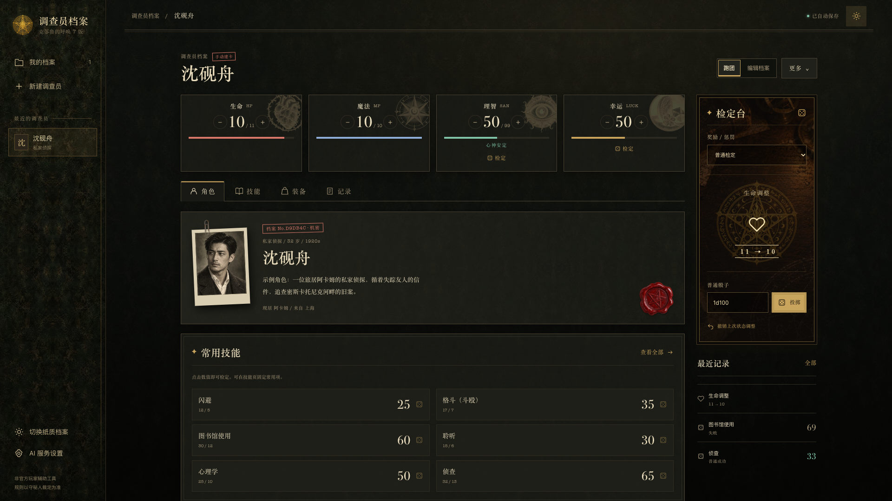

# 调查员档案

用于《克苏鲁的呼唤》第七版的建卡与个人跑团工具。从一句人物构想到完整角色卡，再到开团时查技能、掷骰和记状态，都在同一份档案里完成。

支持电脑和手机，提供纸质卷宗、深色工作台两套主题。角色保存在当前浏览器，无需注册账号。

**[在线体验](https://noechou.github.io/coc-investigator-generator/)** · [本地运行与部署](docs/DEVELOPMENT.md) · [全部页面截图](page-overview/README.md)

## 界面预览

纸质卷宗：限阅书库与调查员档案库。


深色工作台：当前状态、常用技能和检定记录。



## 先建一张卡

打开首页，点击“新建调查员”，选择适合自己的方式：

| 方式 | 怎么用 |
|---|---|
| AI 人设生成 | 写一句人物概念，由 AI 提出属性、职业、技能、装备和背景，生成后逐项审阅。需要自带 API 密钥。 |
| 规则掷骰 | 按 7 版骰式生成属性，保留骰点与年龄修正记录，再选择职业、分配技能。 |
| 手动建卡 | 从空白卡开始，自己填写属性、职业、专长和背景。 |

例如：“一位回到阿卡姆的战地医生，每周四都会收到失踪战友寄来的信。”

生成结果先存为草稿，可以随时继续编辑。程序计算职业点、兴趣点和衍生属性，并提示待检查项；确认后点击“完成建卡”。初始技能上限可以按团内规则调整。

AI 的属性会标为“人设生成”，不代表真实掷骰。没有密钥也能使用随机、手动建卡和跑团功能；想先熟悉界面，可以打开首页的示例角色。

## 开团时这样用

- **查卡与检定**：收藏常用技能，搜索完整技能表；点击技能、属性、理智或幸运即可检定，查看成功等级。支持奖励骰、惩罚骰和普通骰子。
- **记录状态**：调整生命、魔法、理智和幸运，支持撤销。普通检定不会自动扣除资源。
- **整理线索**：在调查笔记里记录线索、人物关系和待办，为检定记录补充备注。
- **带走角色卡**：导出 JSON，或打开打印预览，用浏览器打印、保存 PDF。

界面加入了档案纸与皮革材质、状态徽记、检定反馈和理智变化的氛围效果。AI 或掷骰生成角色后会播放“帷幕破碎”揭示动画，点击可跳过；系统开启“减少动态效果”时会关闭动效。这些视觉提示不代替守秘人的规则裁定。

## 存档在哪里？换设备怎么办？

修改会自动保存在**当前浏览器**。清除网站数据、换浏览器或换设备，都可能使你无法直接看到原来的角色，所以请定期备份。

电脑和手机之间转移角色：在原设备导出 JSON，将文件发送到另一台设备，再从首页“导入档案”。也可以备份整个档案库。

同一角色已存在时，导入默认另存副本；只有明确选择“整卡替换”才覆盖。两台设备各自的修改不会自动合并。

## AI 怎么配置？

打开“AI 服务设置”，填写自己的密钥。内置 DeepSeek 预设，也支持自定义兼容 Chat Completions 的服务地址和模型名。

请求由浏览器直接发送到你选择的服务，人物概念等生成所需资料也会一并发送。密钥仅保留在当前页面会话中，不进入角色档案、备份或导出文件；刷新后需重新填写。服务地址和模型偏好会记住。

自定义服务需要允许浏览器直连。认证、额度、跨域或超时问题会在页面提示。生成内容可以修改，人物背景也可以单独重写。

**验证状态：**生成流程已通过模拟请求验证，真实 AI 服务尚未联调。不同服务的模型与跨域设置仍需实际确认。

## 自己运行或继续开发

需要 Node.js 22.12+。安装和启动：

```bash
npm ci
```

```bash
npm run dev
```

访问 `http://127.0.0.1:5173/`。新版源码需要构建，不能沿用旧版“双击 HTML”的运行方式。

完整的构建、GitHub Pages 发布、测试命令和目录说明见 [开发与部署文档](docs/DEVELOPMENT.md)。供 agent 接手的 [页面总览](page-overview/README.md) 包含 18 张原始 1920×1080 截图，以及页面与源码的对应关系。

## 项目范围与许可

本项目为非官方玩家工具，与 Chaosium 无关联。使用 MIT 许可证，见 [LICENSE](LICENSE)。
